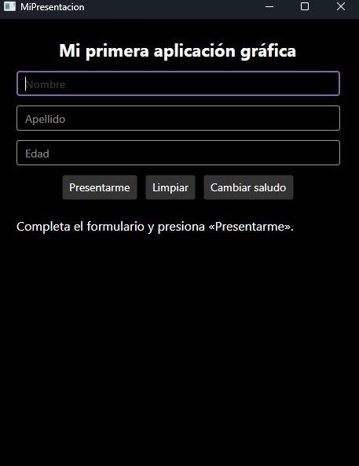
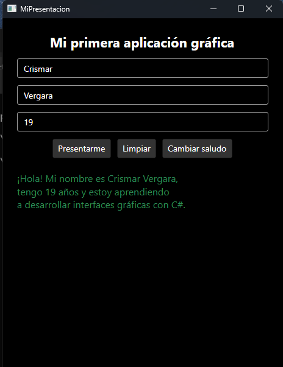
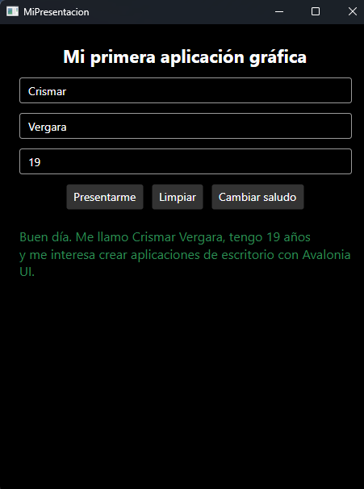

# MiPresentacion

Autor: **CRISMAR VERGARA**

## Descripción
Aplicación de escritorio hecha con **C# y Avalonia UI 11**. Permite ingresar nombre,
apellido y edad, validar los datos y mostrar una presentación personalizada.

## Controles
| Control | x:Name | Función |
|---|---|---|
| `TextBlock` | — | Título «Mi primera aplicación gráfica» |
| `TextBox` | `TxtNombre`, `TxtApellido`, `TxtEdad` | Entrada de datos |
| `Button` | `BtnPresentarme` | Valida y muestra la presentación |
| `Button` | `BtnLimpiar` | Limpia el formulario y devuelve el foco al nombre |
| `Button` | `BtnCambiarSaludo` | (Reto) alterna entre dos saludos |
| `TextBlock` | `TxtResultado` | Muestra el resultado o la advertencia |
| `StackPanel` | — | Organiza los controles (`Margin` y `Spacing`) |

## Funcionamiento delos eventos
- **Presentarme (`Click`)**: lee los tres campos, comprueba que nombre y apellido no estén
  vacíos ni solo con espacios, valida la edad con `int.TryParse()` y que sea mayor que 0.
  Si todo es correcto muestra la presentación; si no, una advertencia.
- **Limpiar (`Click`)**: vacía los campos, restaura el mensaje inicial y llama a `Focus()`
  sobre `TxtNombre`.
- **Cambiar saludo (`Click`)**: cambia una bandera booleana y vuelve a mostrar la
  presentación con el otro mensaje, sin reiniciar la aplicación.

## Còmo ejecutar
Requisito: [.NET 8 SDK](https://dotnet.microsoft.com/download).

```bash
git clone https://github.com/crismarvergara0916-bot/MiPresentacion.git
cd MiPresentacion
dotnet run
```

## Pruebas realizadas
| Caso | Datos | Resultado esperado |
|---|---|---|
| 1 | Datos válidos | Muestra la presentación |
| 2 | Nombre vacío | Advertencia |
| 3 | Apellido vacío | Advertencia |
| 4 | Edad con letras | Solicita edad numérica |
| 5 | Edad ≤ 0 | Rechaza la edad |
| 6 | Limpiar | Restablece el formulario |

## Capturas de pantalla
<!-- Agrega tus capturas en una carpeta "capturas/" y enlázalas aquí -->




## Pregunta de reflexión
**¿Cuál es la función de MainWindow.axaml y MainWindow.axaml.cs, y cómo se relacionan mediante x:Name y los eventos Click?**

_MainWindow.axaml es el archivo donde se diseña la ventana de la aplicación, es decir, donde se colocan los botones, textos y otros elementos visuales. Por otro lado, MainWindow.axaml.cs contiene el código que permite que esos elementos funcionen. Se relacionan mediante x:Name, que sirve para identificar los elementos y utilizarlos desde el código, y los eventos Click, que permiten ejecutar una acción cuando el usuario presiona un botón._
